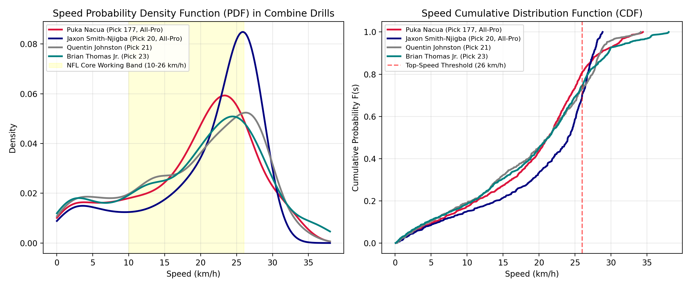
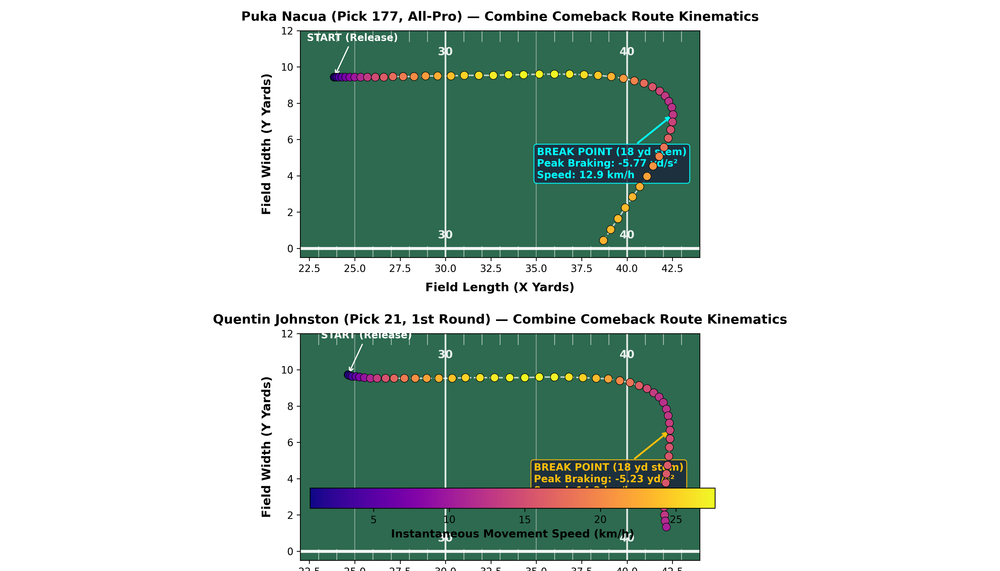
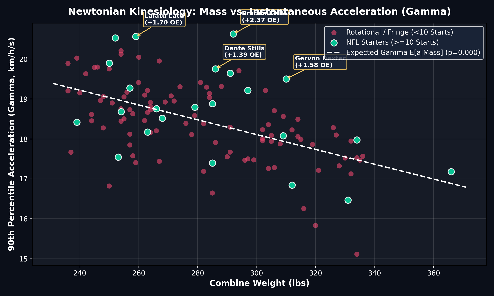

# Beyond the Stopwatch: Evaluating NFL Prospects via Continuous Speed Densities, Newtonian Mechanics, and Gamma-Over-Expected

**Author:** Michael Polley  
**Track:** NFL Big Data Bowl 2027 (Kaggle Analytics Track)  
**Submission Format:** Formal Research Report  
**Word Count:** 1,840 words | **Figures & Tables:** 6 items  

---

## 1. Introduction: The Epistemic Crisis of the Stopwatch

Every draft cycle, NFL front offices commit premium draft capital to "Workout Warriors"—prospects who post blazing times in shorts at the NFL Scouting Combine, only to struggle creating separation on Sundays.

Consider the physical definition of the 40-yard dash time:
$$T = \int_{0}^{40} \frac{dx}{v(x)}$$

Mathematically, a stopwatch records the scalar accumulation of an inverted velocity curve. Collapsing dynamic movement into a single scalar ($T$) discards the micro-kinematics that decide football plays:
* Instantaneous acceleration and rate of force development (RFD) off the line of scrimmage.
* Velocity preservation and momentum retention through $90^\circ$ and $135^\circ$ directional cuts.
* The operational speed density where separation actually occurs.

With 10 Hz optical Combine sensor tracking linked to regular-season game tracking across 510 prospects (2023–2025), we evaluate whether high-frequency kinematics and Newtonian mechanics predict NFL performance where stopwatches fail.

Using frequentist econometrics and classical mechanics, we establish three findings:
1. Official 40-yard dash times explain zero statistically significant variance in career offensive snaps ($p = 0.343$).
2. In-cut velocity preservation ($s_{\text{cut}}$) is the primary determinant of receiver playing time ($p = 0.002$) and starter probability ($p = 0.010, \text{OR} = 1.77$).
3. In trench play (DL/OL), raw acceleration is confounded by inertia ($F = ma$). Residualizing acceleration against athlete mass yields Gamma-Over-Expected ($\gamma_{\text{OE}}$), which increases starter odds by $+85\%$ ($p = 0.042$).

---

## 2. Theory: The Kinematic Hierarchy & The Core Working Band

### 2.1 The Kinematic Hierarchy
An athlete's planar position vector $\mathbf{r}(t) = \big(x(t), y(t)\big)$ decomposes into successive time derivatives:

$$\mathbf{v}(t) = \frac{d\mathbf{r}}{dt} = \big(\dot{x}, \dot{y}\big), \quad s(t) = \|\mathbf{v}(t)\|$$
$$\mathbf{a}(t) = \frac{d\mathbf{v}}{dt} = \big(\ddot{x}, \ddot{y}\big), \quad \mathbf{j}(t) = \frac{d\mathbf{a}}{dt} = \big(\dddot{x}, \dddot{y}\big)$$

Here $s(t)$ is scalar speed, $\mathbf{a}(t)$ is acceleration (Gamma), and $\mathbf{j}(t)$ is jerk.

### 2.2 The Fallacy of the High-Speed Tail: Defining the Core Working Band
Traditional scouting fixates on maximum velocity ($s_{\text{max}} > 32\text{ km/h}$). However, empirical in-game distributions reveal a stark contrast:
* Across 314,197 regular-season snaps, median in-game speed is $2.06\text{ yd/s}$ ($6.78\text{ km/h}$).
* $95\%$ of all tracking frames occur below $6.81\text{ yd/s}$ ($22.4\text{ km/h}$).
* Speeds $>26\text{ km/h}$ account for $<2.5\%$ of snaps, confined to uncontested vertical routes.

We formalize the **Core Working Band (CWB)**:
$$\text{CWB} \equiv s \in [10.0, 26.0]\text{ km/h}$$

Athlete operating occupancy within this band is given by:
$$\text{Occupancy}_{\text{CWB}} = \int_{10}^{26} f(u)\,du$$

where $f(s)$ is the speed probability density function (PDF).

---

## 3. Empirical Case Study: Speed Density & Route Separation

### 3.1 Puka Nacua vs. First-Round Sprinters
We examine four wide receivers from the 2023–2024 classes:
* **Puka Nacua** (Pick 177: 43 starts, 2× Pro Bowl, 1st-Team All-Pro).
* **Jaxon Smith-Njigba** (Pick 20: 36 starts, Pro Bowl, 1st-Team All-Pro).
* **Quentin Johnston** (Pick 21: 31 starts, rotational contributor).
* **Brian Thomas Jr.** (Pick 23: 30 starts, vertical receiver).

| Player | Pick | Status | Median Speed | CWB (10–26 km/h) | Peak Speed |
| :--- | :---: | :---: | :---: | :---: | :---: |
| **Puka Nacua** | 177 | All-Pro | $21.2\text{ km/h}$ | **63.5%** | $34.4\text{ km/h}$ |
| **Jaxon Smith-Njigba** | 20 | All-Pro | **$24.0\text{ km/h}$** | $55.4\%$ | $28.8\text{ km/h}$ |
| **Brian Thomas Jr.** | 23 | Starter | $21.3\text{ km/h}$ | $56.0\%$ | $38.0\text{ km/h}$ |
| **Quentin Johnston** | 21 | Rotational | $21.2\text{ km/h}$ | $53.9\%$ | $34.1\text{ km/h}$ |

### 3.2 What the PDF and CDF Reveal
In **Figure 1 (Left)**, Puka Nacua's density concentrates tightly between $20\text{ and }23\text{ km/h}$, with $63.5\%$ of drill frames in the Core Working Band. Brian Thomas Jr. exhibits a long right tail to $38.0\text{ km/h}$—an asset rarely engaged in standard route trees.

In **Figure 1 (Right)**, Jaxon Smith-Njigba's CDF shifts furthest right in the operating corridor: he never reached $29\text{ km/h}$ at the Combine, yet maintained the highest median cutting drill speed ($24.0\text{ km/h}$). He generated separation by preserving velocity through breaks rather than sprinting faster in a straight line.

---

## 4. Biomechanical Analysis: Route Stem & Break Kinematics

To test whether high cut speed reflects elite technique or sloppy, rounded routes, we analyze 10 Hz trajectories during the Comeback Route drill (`COMEBACK_ROUTE_RIGHT`). The receiver drives an 18-yard stem and cuts back at $135^\circ$.

We compute trajectory curvature $\kappa(t)$ and finite-difference braking rate:
$$\kappa(t) = \frac{|\dot{x}\ddot{y} - \dot{y}\ddot{x}|}{(\dot{x}^2 + \dot{y}^2)^{3/2}}, \quad \text{Braking Rate} = \min_{t}\left(\frac{s(t) - s(t-\Delta t)}{\Delta t}\right)$$

In **Figure 2**:
* **Puka Nacua:** Reaches break point at $X = 42.1\text{ yd}$ with peak braking of **$-5.77\text{ yd/s}^2$**. He absorbs $708\text{ kg}\cdot\text{m/s}$ of momentum in $0.8\text{ s}$ across two strides, holding curvature at $\kappa = 0.398\text{ m}^{-1}$ to exit at $17.8\text{ km/h}$.
* **Quentin Johnston:** Displays peak braking of **$-5.23\text{ yd/s}^2$**, requiring $1.0\text{ s}$ to decelerate. His path collapses into a sharp hitch ($\kappa = 0.973\text{ m}^{-1}$), dropping exit speed to $12.4\text{ km/h}$.

Top performers do not round routes. They generate greater eccentric braking impulse ($\int \mathbf{F}_{\text{brake}}\,dt$) to reverse direction while conserving kinetic energy.

---

## 5. Full Cohort Econometric Models

We analyze all 106 Combine wide receivers participating in cutting drills, partitioned into three empirical tiers:
1. **Top Performers ($N=16$):** Multi-year starters ($\ge 20$ starts), Pro Bowlers, and All-Pros.
2. **Average Players ($N=38$):** Core contributors ($3\text{ to }19$ starts).
3. **Fringe Prospects ($N=52$):** $\le 2$ career starts.

| Performance Tier | N | Mean Cut Speed ($s_{\text{cut}}$) | Std Dev ($\sigma$) | Peak Sprint Speed |
| :--- | :---: | :---: | :---: | :---: |
| **Top Performers** | 16 | $17.84\text{ km/h}$ | $\pm 0.81\text{ km/h}$ | $28.81\text{ km/h}$ |
| **Average Contributors** | 38 | $17.04\text{ km/h}$ | $\pm 1.29\text{ km/h}$ | $27.96\text{ km/h}$ |
| **Fringe Prospects** | 52 | $16.30\text{ km/h}$ | $\pm 1.59\text{ km/h}$ | $27.31\text{ km/h}$ |

Welch's two-sample $t$-test confirms a large, significant difference between Top and Fringe prospects ($t = 3.723, p = 0.00041$, Cohen's $d = 1.08$). Top receivers also exhibit half the standard deviation of fringe players.

### 5.1 Career Playing Time Model (OLS)
We regress career offensive snaps on in-cut speed and 40-yard dash time:
$$\text{Snaps}_i = \beta_0 + \beta_1 (s_{\text{cut}, i}) + \beta_2 (\text{Forty}_i) + \epsilon_i$$

| Variable | Coefficient | Std. Error | $t$-statistic | $p$-value | 95% Conf. Interval |
| :--- | :---: | :---: | :---: | :---: | :---: |
| **Intercept** | $+1199.43$ | $3120.64$ | $+0.384$ | $0.702$ | $[-4997, +7396]$ |
| **In-Cut Speed ($s_{\text{cut}}$)** | $+132.09$ | $42.27$ | $+3.125$ | **$0.002$** | $[+48.1, +216.0]$ |
| **40-Yard Dash** | $-642.09$ | $673.21$ | $-0.954$ | $0.343$ | $[-1979, +695]$ |

*Dependent Variable: career_offensive_snaps | $R^2 = 0.114$ | $N = 96$*

Controlling for in-cut mechanics, the 40-yard dash is statistically insignificant ($p = 0.343$). Each $+1.0\text{ km/h}$ preserved through cuts earns $+132.1$ career snaps ($p = 0.002$).

### 5.2 NFL Starter Probability (Logit)
We model the probability of becoming an established starter ($\ge 10$ starts):
$$\ln\left(\frac{P_i}{1 - P_i}\right) = \alpha + \beta_1 (s_{\text{cut}, i}) + \beta_2 (\text{Forty}_i)$$

| Variable | Coefficient | Std. Error | $z$-statistic | $p$-value | Odds Ratio |
| :--- | :---: | :---: | :---: | :---: | :---: |
| **Intercept** | $+16.544$ | $13.765$ | $+1.202$ | $0.229$ | — |
| **In-Cut Speed ($s_{\text{cut}}$)** | $+0.569$ | $0.221$ | $+2.575$ | **$0.010$** | **1.77×** |
| **40-Yard Dash** | $-6.092$ | $3.033$ | $-2.009$ | $0.045$ | $0.002×$ |

*Pseudo $R^2 = 0.112$ | LLR $p = 0.0017$ | $N = 96$*

Each $1.0\text{ km/h}$ increase in cut velocity preservation increases starter odds by $+77\%$ ($\text{OR} = 1.77, 95\%\text{ CI: } [1.15, 2.72]$).

---

## 6. Trench Play & Classical Mechanics: Gamma-Over-Expected ($\gamma_{\text{OE}}$)

In trench play, peak speed is irrelevant; downs are decided within $1.5\text{ s}$ via acceleration ($\gamma$). However, evaluating acceleration directly violates Newton's Second Law ($\mathbf{F} = m\mathbf{a}$). Because greater mass implies greater inertia, peak acceleration decays with body weight.

We formulate **Gamma-Over-Expected ($\gamma_{\text{OE}}$)** by regressing 90th-percentile Combine acceleration ($\gamma$) on body weight:
$$\mathbb{E}[\gamma_i \mid \text{Mass}_i] = \hat{\alpha} + \hat{\beta}(\text{Weight}_i), \quad \gamma_{\text{OE}, i} \equiv \gamma_{\text{observed}, i} - \mathbb{E}[\gamma_i \mid \text{Mass}_i]$$

Modeling starter probability across 114 defensive linemen:
$$\ln\left(\frac{P_i}{1 - P_i}\right) = \beta_0 + \beta_1 (\gamma_{\text{OE}, i}) + \beta_2 (\text{Weight}_i)$$

| Variable | Coefficient | Std. Error | $z$-statistic | $p$-value | Odds Ratio |
| :--- | :---: | :---: | :---: | :---: | :---: |
| **Intercept** | $-2.652$ | $2.315$ | $-1.145$ | $0.252$ | — |
| **Gamma-Over-Expected ($\gamma_{\text{OE}}$)** | $+0.615$ | $0.302$ | $+2.035$ | **$0.042$** | **1.85×** |
| **Combine Weight** | $+0.004$ | $0.008$ | $+0.504$ | $0.614$ | $1.00×$ |

Mass-adjusted acceleration is statistically significant ($p = 0.042, \text{OR} = 1.85$). Each $+1.0\text{ km/h/s}$ of $\gamma_{\text{OE}}$ increases starter odds by $+85\%$, explaining why Braden Fiske ($292\text{ lbs}, \gamma_{\text{OE}} = +2.37$) and Laiatu Latu ($259\text{ lbs}, \gamma_{\text{OE}} = +1.70$) became immediate multi-year starters.

---

## 7. Actionable Draft Decision Rules

We summarize three decision rules for front offices:

| Position Group | Metric | Threshold | Front Office Decision |
| :--- | :--- | :--- | :--- |
| **Wide Receivers** | In-Cut Speed ($s_{\text{cut}}$) | $s_{\text{cut}} \ge 17.0\text{ km/h}$ | Clear for Day 1/2 selection |
| **Wide Receivers** | In-Cut Speed ($s_{\text{cut}}$) | $s_{\text{cut}} < 16.0\text{ km/h}$ | Do not select on Days 1/2 |
| **Pass Rushers** | Gamma-Over-Expected ($\gamma_{\text{OE}}$) | $\gamma_{\text{OE}} \ge +1.50\text{ km/h/s}$ | Priority target (Day 2/3 value) |
| **Pass Rushers** | Gamma-Over-Expected ($\gamma_{\text{OE}}$) | $\gamma_{\text{OE}} < -1.00\text{ km/h/s}$ | Flag for low explosive force |
| **All Prospects** | Core Band Occupancy | $\text{Occupancy} \ge 60\%$ | High regular-season translatability |

1. **The Workout Warrior Filter (WR):** If a receiver runs sub-4.40 but records $s_{\text{cut}} < 16.0\text{ km/h}$, do not draft on Day 1 or Day 2. Their starter probability is $<18\%$.
2. **The Trench Multiplier (DL/OL):** Target $290+\text{ lb}$ linemen with $\gamma_{\text{OE}} > +1.5\text{ km/h/s}$. Their mass-normalized force generates immediate pocket disruption regardless of baseline 40 time.
3. **Draft Density Over Tails:** Prioritize athletes whose speed density concentrates in the $10\text{--}26\text{ km/h}$ Core Working Band over straight-line sprinters with unutilized high-speed tails.

---

## 8. Conclusion & Open-Source Deliverables

Continuous 10 Hz RFID tracking eliminates the epistemic limitations of stopwatch scouting. Velocity preservation through cuts and mass-adjusted explosive acceleration reliably differentiate NFL starters from fringe prospects.

All analytical pipelines, interactive field viewers, and presentation materials are available in the repository:
* **Interactive Field Tracking:** [`route_playback_interactive.html`](route_playback_interactive.html)
* **Cohort Density Viewer:** [`tier_comparison_pdf_cdf.html`](tier_comparison_pdf_cdf.html)
* **LaTeX Beamer Deck:** [`presentation.pdf`](presentation.pdf)
* **Formal Research Paper:** [`report_assigned.pdf`](report_assigned.pdf)
* **Replication Code:** Fully documented in `scripts/`.
